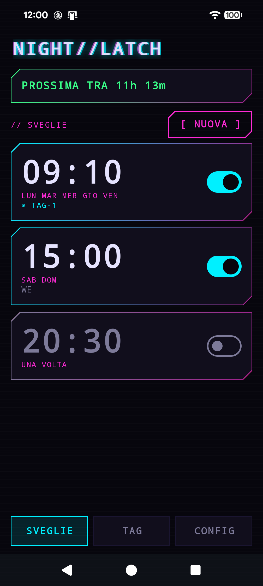
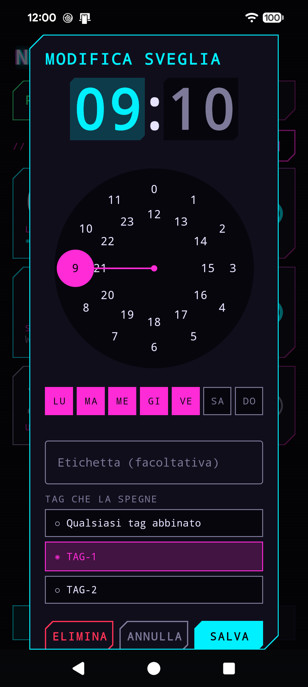
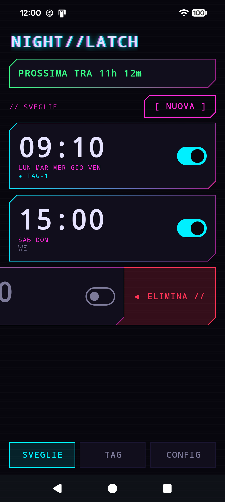
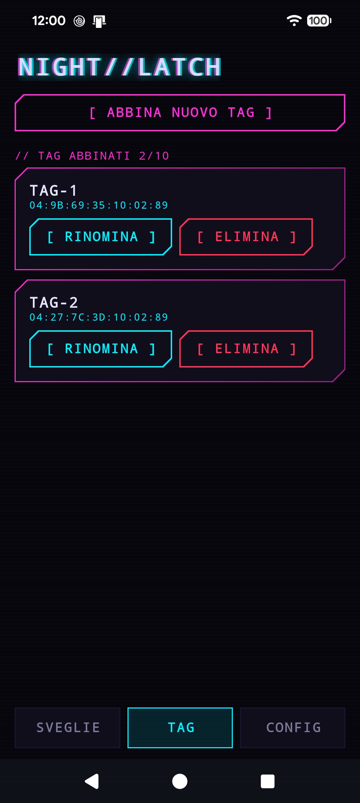
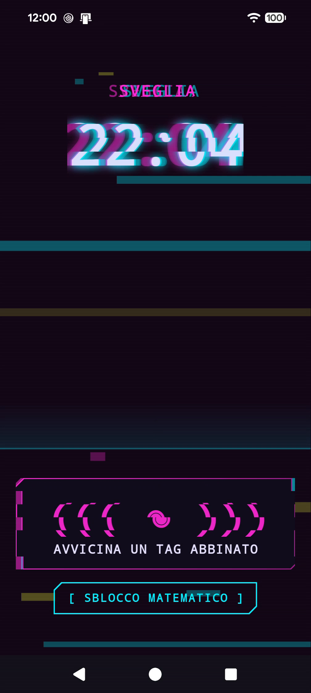
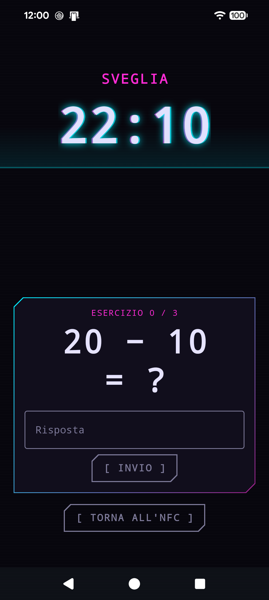
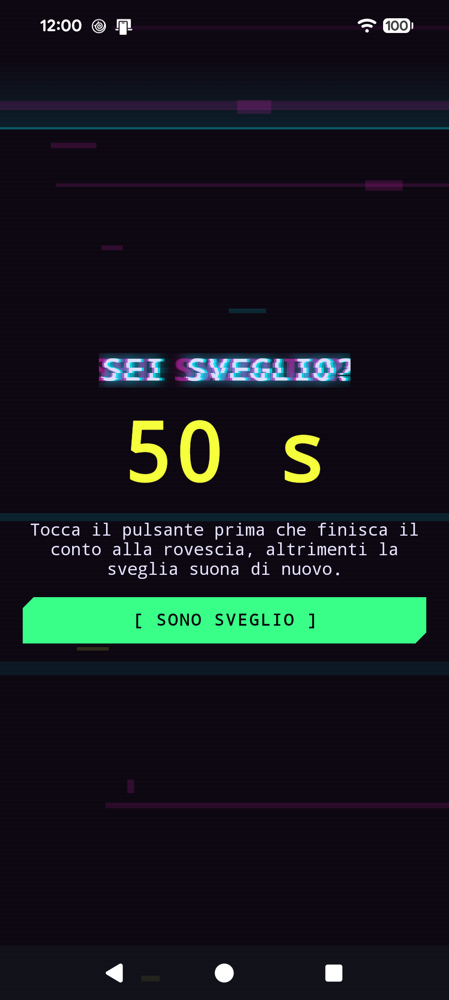
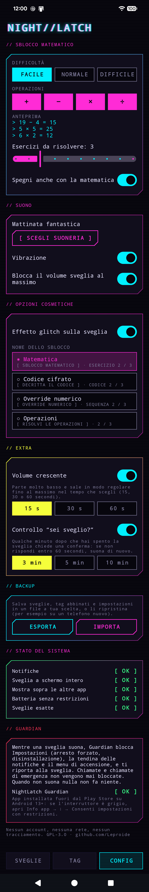
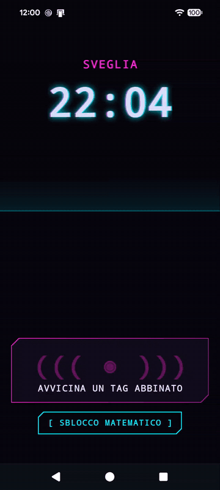
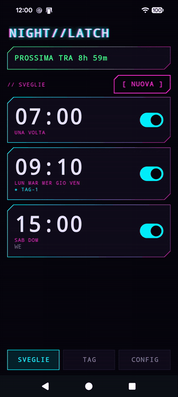

<p align="center"></p>

# NIGHT//LATCH

Sveglia Android in stile cyberpunk che spegni solo **alzandoti e avvicinando uno dei tuoi tag NFC**, per esempio un adesivo in bagno o in cucina. Se il tag non è a portata di mano, c'è uno **sblocco matematico** configurabile come riserva.

Nessun account, nessun abbonamento, nessuna pubblicità, nessuna rete (l'app non ha nemmeno il permesso `INTERNET`), nessun tracciamento.

Documentazione in inglese: [README.md](README.md)

> **Lingua:** gli screenshot qui sotto sono fatti con il telefono in italiano. L'app è bilingue, **italiano e inglese**: segue la lingua del telefono e da Android 13 puoi sceglierla per la singola app in *Impostazioni → App → NightLatch → Lingua*.

## Screenshot

<p>
  <a href="docs/screenshots/01-alarms.png"></a>
  <a href="docs/screenshots/02-alarm-edit.png"></a>
  <a href="docs/screenshots/03-swipe-delete.png"></a>
  <a href="docs/screenshots/04-tags.png"></a>
</p>
<p>
  <a href="docs/screenshots/06-ringing.png"></a>
  <a href="docs/screenshots/07-math-unlock.png"></a>
  <a href="docs/screenshots/08-wake-check.png"></a>
  <a href="docs/screenshots/05-config.png"></a>
</p>

Effetto glitch mentre suona ed eliminazione con lo swipe:

<p>
  
  
</p>

## Come funziona, in 30 secondi

1. **Abbina i tuoi tag** nella scheda TAG: va bene qualsiasi adesivo, tessera o portachiavi NFC.
2. **Crea una sveglia** nella scheda SVEGLIE e scegli se la spegne **qualsiasi tag abbinato** o **solo un tag specifico** (per esempio quello in bagno).
3. Quando suona, la schermata della sveglia si apre **sopra la schermata di blocco** e continua finché non avvicini il tag giusto, o finché non risolvi lo sblocco matematico se l'hai consentito.
4. Se vuoi, qualche minuto dopo l'app chiede **"Sei sveglio?"**: se non confermi, suona di nuovo.

## Sveglie (scheda SVEGLIE)

- **NUOVA** crea una sveglia; toccando una sveglia si apre la modifica; l'interruttore la attiva o disattiva senza cancellarla.
- **Orario:** quadrante, a 24 o 12 ore secondo l'impostazione del telefono.
- **Giorni di ripetizione:** tocca i giorni che vuoi (LUN…DOM). Le sveglie nuove partono **senza giorni selezionati**: in quel caso la sveglia suona **una volta sola** e poi si disattiva. Nell'elenco vedi i giorni scelti, *OGNI GIORNO* o *UNA VOLTA*.
- **Etichetta:** testo facoltativo, mostrato nell'elenco e sulla schermata della sveglia.
- **Tag che la spegne** (compare se hai almeno un tag abbinato):
  - **Qualsiasi tag abbinato** (default): la spegne ogni tag che hai abbinato.
  - **Un tag specifico:** la spegne solo quel tag; gli altri vengono rifiutati con *TAG SCONOSCIUTO // ACCESSO NEGATO*. Nell'elenco compare sotto la sveglia (es. `◉ TAG-1`) e sulla schermata della sveglia leggi *AVVICINA IL TAG: TAG-1*.
  - Puoi combinarli: per esempio la sveglia dei giorni feriali si spegne solo col tag in bagno, quella del weekend con qualsiasi tag.
  - Se rimuovi un tag da cui dipende una sveglia, quella sveglia torna in automatico a *qualsiasi tag abbinato*.
- **Eliminare:** trascina la sveglia **verso sinistra oltre metà della sua larghezza** e rilascia (effetto glitch, vedi la GIF sopra); se rilasci prima torna al suo posto. Oppure usa ELIMINA nella finestra di modifica. Non si può annullare.
- Il riquadro in alto mostra quanto manca alla prossima sveglia.
- Tecnicamente le sveglie usano `AlarmManager.setAlarmClock()`: suonano puntuali anche in Doze e mostrano l'icona sveglia nella barra di stato. Sopravvivono a riavvii, cambi d'ora e di fuso orario.

## Tag NFC (scheda TAG)

- **ABBINA NUOVO TAG**, poi appoggia il tag sul retro del telefono. Fino a **50 tag**, ognuno con un nome modificabile (RINOMINA) e il suo UID sotto.
- L'identità del tag è il suo **UID hardware**. NightLatch non legge né scrive mai la memoria del tag, quindi funzionano anche tag vuoti, non formattati o già usati.
- **Non accettati:** carte bancarie, passaporti e telefoni che emulano una carta. Usano un **UID casuale** che cambia a ogni lettura, quindi non si possono riconoscere.
- Con NightLatch aperta, i tag appoggiati al telefono **non aprono mai l'app NFC predefinita**.

## Quando suona

- La schermata della sveglia si apre **sopra la schermata di blocco**, accende lo schermo e lo tiene acceso.
- **Avvicina un tag** (quello richiesto, se la sveglia ha un tag specifico).
  - **Telefono bloccato:** la maggior parte dei telefoni, **Pixel compresi**, non legge i tag NFC a schermo bloccato e nessuna app può cambiarlo. Finché il telefono è bloccato NightLatch mostra un riquadro grande *TELEFONO BLOCCATO*: sblocca con impronta o volto direttamente sulla schermata della sveglia, oppure tocca il riquadro per il PIN. La sveglia continua a suonare e resta in primo piano; poi avvicina il tag.
- Pulsante **sblocco matematico** (se consentito): funziona **anche a telefono bloccato**.
- **Indietro** e **tasti del volume** non fanno nulla mentre suona.
- **Effetto glitch** facoltativo: linea di scansione, strisce al neon, l'orario e il riquadro NFC che si spezzano ogni pochi secondi. Il pannello dei calcoli e i pulsanti non vengono mai glitchati.

## Sblocco matematico

La riserva per quando il tag non è a portata di mano, o lo sblocco principale se non usi tag. Si configura tutto in CONFIG, con un'**anteprima** dal vivo di tre esercizi.

| Livello | Lunghezza | Esempi |
|---|---|---|
| Facile | 1 operazione, numeri piccoli | `13 + 20`, `12 − 6`, `4 × 3`, `20 ÷ 5` |
| Normale | 1–2 operazioni, numeri a due cifre | `31 + 39 − 28`, `3 × 5 × 9`, `36 ÷ 3 ÷ 4` |
| Difficile | 2–3 operazioni in catena, con le precedenze | `12 × 6 ÷ 2 + 3`, `45 + 10 × 10`, `63 ÷ 3 ÷ 7` |

- **Operazioni:** accendi o spegni `+ − × ÷`; la scelta vale per tutti i livelli e almeno una resta sempre attiva.
- **Esercizi da risolvere:** da 1 a 10. Una risposta sbagliata genera un nuovo esercizio senza perdere quelli già risolti.
- Le divisioni sono sempre esatte e i risultati sempre interi positivi.
- **Spegni anche con la matematica** (interruttore): spegnilo se vuoi che il tag sia l'unico modo.
  Viene comunque **forzato acceso** quando un tag non si può usare: nessun tag abbinato, telefono senza NFC o NFC spento. Una sveglia non può mai diventare impossibile da spegnere.

## Controllo "sei sveglio?" (facoltativo)

- Si attiva in CONFIG → EXTRA, scegliendo **3, 5 o 10 minuti**.
- Passato quel tempo da quando hai spento la sveglia (con tag o con la matematica), compare *SEI SVEGLIO?* con un **conto alla rovescia di 60 secondi** e brevi impulsi di vibrazione.
- Si conferma solo con il pulsante **SONO SVEGLIO**. I tag qui non valgono, apposta: devi guardare il telefono.
- Se non confermi in tempo, la sveglia **suona di nuovo**, e dopo che l'hai spenta il controllo si ripete.

## Suono

- **Suoneria:** qualsiasi suono sveglia dal selettore di sistema. Se quella scelta non si può riprodurre, usa il suono sveglia predefinito.
- **Vibrazione** sì/no.
- **Blocca il volume sveglia al massimo:** se qualcuno (tu, mezzo addormentato) abbassa il volume sveglia, entro un secondo torna su.
- **Volume crescente** (facoltativo): parte da −30 dB e sale in modo regolare (lineare in dB, quindi *si sente* uniforme) fino al massimo in **15, 30 o 60 secondi**.
- **Telefonate:** mentre una chiamata squilla o è in corso (anche VoIP), il suono della sveglia va in pausa e la vibrazione continua; riprende a fine chiamata.

## Opzioni cosmetiche

- **Effetto glitch sulla sveglia** (attivo di default).
- **Nome dello sblocco:** come si chiama lo sblocco matematico nell'app. Cambiano solo le scritte, il funzionamento resta lo stesso:

| Opzione | Pulsante sulla sveglia | Contatore |
|---|---|---|
| Matematica (default) | SBLOCCO MATEMATICO | ESERCIZIO 2 / 3 |
| Codice cifrato | DECRITTA IL CODICE | CODICE 2 / 3 |
| Override numerico | OVERRIDE NUMERICO | SEQUENZA 2 / 3 |
| Operazioni | RISOLVI LE OPERAZIONI | 2 / 3 |

## Backup

CONFIG → BACKUP: **ESPORTA** salva sveglie, tag abbinati e impostazioni in un file JSON a tua scelta; **IMPORTA** li ripristina, per esempio su un telefono nuovo. All'importazione ogni valore viene controllato; un file che non è un backup NightLatch valido non cambia nulla. Il backup automatico di Android nel cloud è disattivato apposta, quindi questo è il modo per spostare la tua configurazione.

## Difficile da aggirare mentre suona

- **Suono di riserva:** mentre suona c'è sempre un secondo allarme esatto 60 secondi più avanti. Se l'app viene chiusa (tolta dai recenti, chiusa dal risparmio batteria del produttore, crash), la sveglia riparte entro un minuto.
- **Riavvio / aggiornamento:** se il telefono si riavvia o l'app si aggiorna mentre suona, riprende a suonare.
- **Nessun silenziamento automatico:** suona finché non la spegni.
- **Guardian** (servizio di accessibilità facoltativo, vedi sotto): mentre suona blocca Impostazioni, launcher, tendina notifiche e menu di accensione.

### Guardian

Mentre una sveglia suona, Guardian ti riporta alla sveglia se apri **Impostazioni** (arresto forzato, disinstallazione), il **launcher**, la **tendina delle notifiche** o il **menu di accensione**.

- **Telefono, dialer e chiamate di emergenza sono sempre permessi.**
- Vede solo il **nome del pacchetto** dell'app in primo piano, mai il contenuto dello schermo, e **quando non suona nessuna sveglia non fa niente**.
- **Fail-open:** se il servizio della suoneria è morto da più di 5 minuti e il suono di riserva non è riuscito a farlo ripartire, Guardian smette di bloccare, così il telefono non resta mai bloccato senza che nulla suoni.
- Si attiva in *Impostazioni → Accessibilità → NightLatch Guardian*. Se l'interruttore è grigio, vedi [Impostazioni con restrizioni](#impostazioni-con-restrizioni-apk-installato-fuori-dal-play-store).

### Cosa nessuna app può impedire

L'arresto forzato via `adb`, l'avvio in modalità provvisoria, lo spegnimento del telefono o il distacco della batteria. L'arresto forzato da Impostazioni cancella anche tutte le sveglie programmate dall'app: per questo Guardian blocca Impostazioni mentre una sveglia suona.

## Permessi e prima configurazione

Al primo avvio un **wizard** elenca cosa serve, ogni voce con il pulsante SISTEMA che apre la pagina di sistema giusta. In seguito, se Android revoca qualcosa (succede agli aggiornamenti delle app installate fuori dal Play Store), in cima all'app compare un **riquadro rosso** e, dopo un aggiornamento o un riavvio, una **notifica** che apre la pagina giusta con un tocco. Un **riquadro giallo** suggerisce quelli consigliati. Tutto si trova anche in CONFIG → STATO DEL SISTEMA.

| Permesso | Obbligatorio? | A cosa serve |
|---|---|---|
| Notifiche | Necessario (Android 13+) | Mostra la sveglia che suona |
| Sveglia a schermo intero | Necessario (Android 14+) | Apre la schermata della sveglia sopra il blocco |
| Mostra sopra le altre app | Necessario | Permette di aprire la schermata della sveglia anche quando Android salta lo schermo intero (es. dopo un aggiornamento) |
| Sveglie esatte | Necessario (Android 12+) | Suona al minuto esatto |
| Batteria senza restrizioni | Consigliato | Evita che il risparmio batteria del produttore chiuda la sveglia |
| NFC attivo | Consigliato | Serve per spegnere la sveglia con i tag |
| Guardian (accessibilità) | Facoltativo | Anti-fuga mentre suona |

### Impostazioni con restrizioni (APK installato fuori dal Play Store)
Da Android 13, Android blocca alcune impostazioni delle app installate da un APK finché non le sblocchi a mano: **Guardian** (accessibilità) da Android 13 e **Mostra sopra le altre app** da Android 15. L'interruttore risulta grigio oppure Android dice *Impostazione con restrizioni*. Il wizard iniziale lo spiega e ha un pulsante **APRI INFO APP**.

1. Prova una volta ad attivare l'impostazione: Android mostra il blocco, e solo dopo offre l'opzione del passo 2.
2. Apri *Info app* di NightLatch → **⋮** (in alto a destra) → **Consenti impostazioni con restrizioni**, e conferma con PIN, impronta o volto.
3. Torna indietro e attiva l'impostazione.

## Privacy

Nessun account, nessun permesso di rete, nessuna analisi, nessuna pubblicità. Sveglie, UID dei tag e impostazioni restano nella memoria privata dell'app sul telefono. Guardian, se attivo, guarda solo quale app è in primo piano mentre una sveglia suona.

## Requisiti

- Android 8.0 (API 26) o successivo. L'NFC è facoltativo (senza, le sveglie si spengono con lo sblocco matematico).
- Per compilare: JDK 17 e Android SDK (platform 36). La via più semplice è Android Studio.

## Compilazione

```bash
./gradlew testDebugUnitTest   # test JVM (generatore calcoli, orari compreso il cambio dell'ora legale, UID NFC)
./gradlew assembleDebug       # -> app/build/outputs/apk/debug/app-debug.apk
./gradlew assembleRelease     # firmata se esiste keystore.properties (vedi sotto)
```

Windows (PowerShell): `.\gradlew.bat assembleDebug`

### Firma della release (in locale)
1. Crea una volta il keystore e conservalo bene: ogni aggiornamento va firmato con la stessa chiave.
   `keytool -genkeypair -v -keystore nightlatch.jks -keyalg RSA -keysize 4096 -validity 10000 -alias nightlatch`
2. `cp keystore.properties.example keystore.properties` e compilalo. Entrambi i file sono esclusi da git: non committarli mai.
3. `./gradlew assembleRelease`

### GitHub Actions
A ogni push su `main` partono i test e il lint, viene compilato l'APK debug e tutto viene caricato come artifact (*Actions → run → Artifacts*). Le debug della CI sono firmate con una chiave usa e getta: per installarne una sopra l'altra devi prima disinstallare.

Per avere dalla CI un **APK release firmato** che si installa come aggiornamento, aggiungi questi secret al repository (*Settings → Secrets and variables → Actions*):

| Secret | Valore |
|---|---|
| `NIGHTLATCH_KEYSTORE_B64` | il keystore in base64 (PowerShell: `[Convert]::ToBase64String([IO.File]::ReadAllBytes("nightlatch.jks")) \| Set-Clipboard`) |
| `NIGHTLATCH_STORE_PASSWORD` | password del keystore |
| `NIGHTLATCH_KEY_ALIAS` | alias della chiave (es. `nightlatch`) |
| `NIGHTLATCH_KEY_PASSWORD` | password della chiave |

Il keystore esiste sul runner solo per la durata del job.

### Pubblicare una release
Facendo il push di un tag di versione viene pubblicata una **GitHub Release** con l'APK firmato con la tua chiave (`.github/workflows/release.yml`):

1. Aumenta `versionCode` e `versionName` in `app/build.gradle.kts`.
2. Note di rilascio facoltative: `fastlane/metadata/android/en-US/changelogs/<versionCode>.txt` (e `it-IT`).
3. Tag e push: `git tag -s v1.0.0 -m "NightLatch 1.0.0"` poi `git push origin v1.0.0`.

Il workflow si rifiuta di pubblicare se il tag non corrisponde a `versionName`, se mancano i secret di firma o se l'APK è firmato in debug. La release contiene `NightLatch-vX.Y.Z.apk`, il suo SHA-256 e l'impronta del certificato di firma, così chi installa può verificare che sia la tua build.

## Installazione e prova

1. Installa l'APK: `adb install -r app-release.apk`, oppure aprilo dal telefono.
2. Segui il wizard finché ogni riga necessaria mostra `[ OK ]`.
3. **TAG → ABBINA NUOVO TAG** per ogni tag.
4. Imposta una sveglia tra uno o due minuti e provala: schermo spento, telefono bloccato, in Doze (`adb shell dumpsys deviceidle force-idle`), dopo aver tolto l'app dai recenti, con Non disturbare attivo.

## Struttura del progetto

```
app/src/main/java/io/github/leproide/nightlatch/
  NightLatchApp.kt                 canali di notifica
  data/Models.kt, Store.kt         sveglie, tag, impostazioni, stato suoneria, backup (JSON validato in preferenze private)
  alarm/AlarmScheduler.kt          setAlarmClock, prossimo orario (ora legale gestita), suono di riserva, controllo sveglio
  alarm/AlarmReceiver.kt           sveglia / riserva / controllo sveglio
  alarm/SystemEventsReceiver.kt    riavvio / cambio ora / aggiornamento -> riprogramma, riprende a suonare, promemoria permessi
  alarm/RingService.kt             servizio in primo piano: suono, vibrazione, pausa in chiamata, volume crescente e bloccato, controllo sveglio
  alarm/GuardianService.kt         accessibilità anti-fuga facoltativa
  alarm/Permissions.kt             permessi necessari/consigliati e relative pagine di impostazioni
  nfc/NfcUid.kt, TagScanner.kt     normalizzazione UID, reader mode
  math/MathChallenge.kt            generatore di calcoli
  ui/                              interfaccia Compose (activity, schermate, tema cyberpunk, effetti glitch, nomi dello sblocco)
app/src/test/                      test JVM
docs/screenshots/                  screenshot e GIF del README
fastlane/metadata/android/         metadati per gli store (F-Droid / IzzyOnDroid)
```

## License

NightLatch è software libero rilasciato sotto la **GNU General Public License v3.0** (o, a tua scelta, qualsiasi versione successiva). Il testo completo è in [LICENSE](LICENSE).

## Author

https://github.com/Leproide
