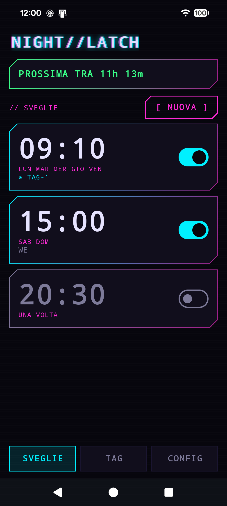
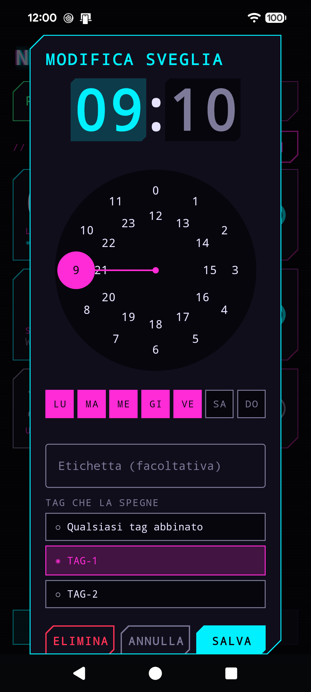
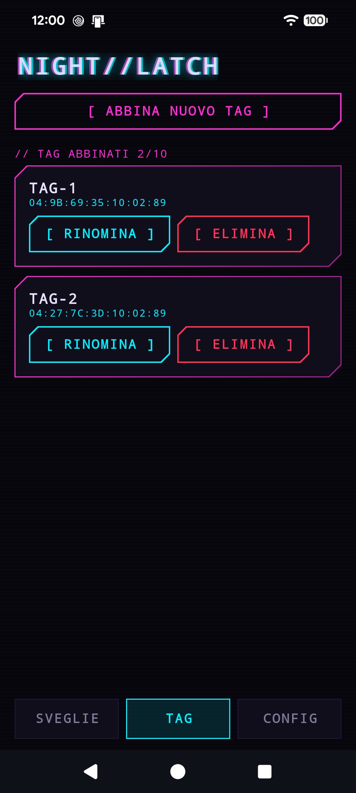
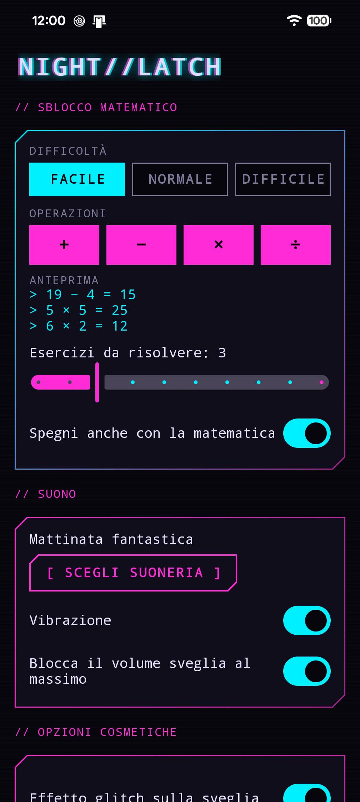
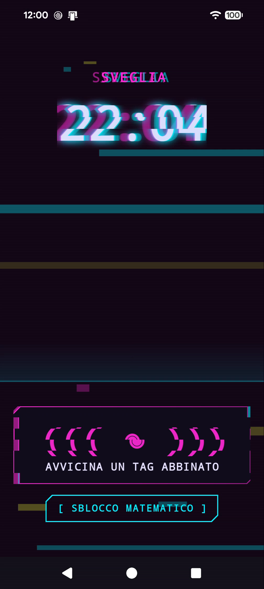
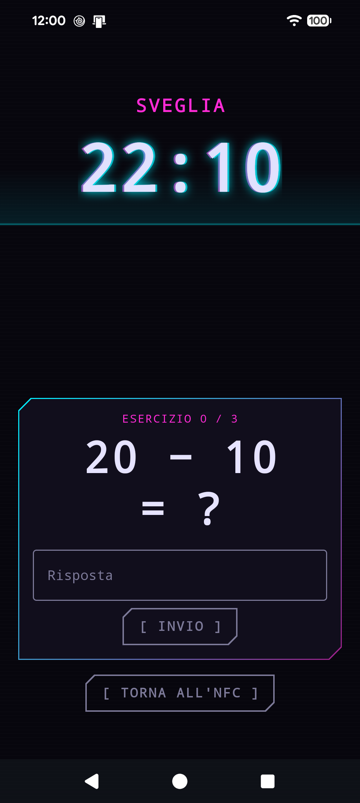
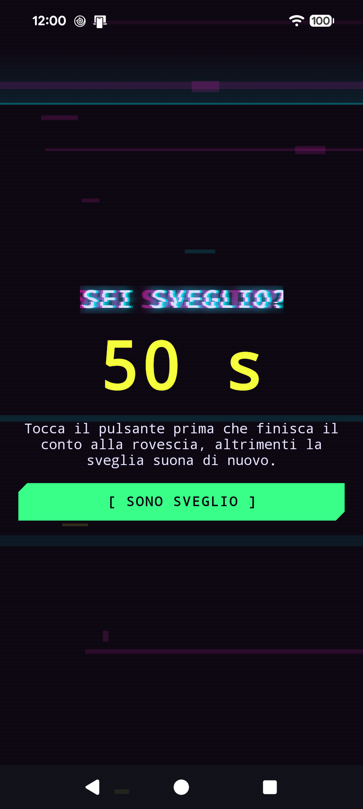
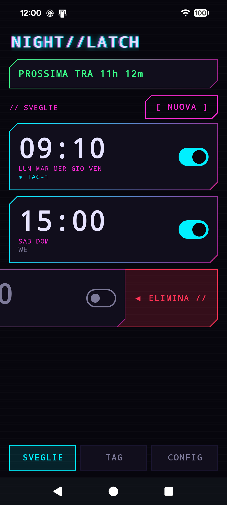
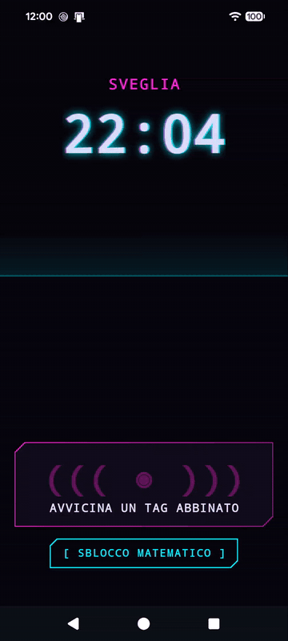
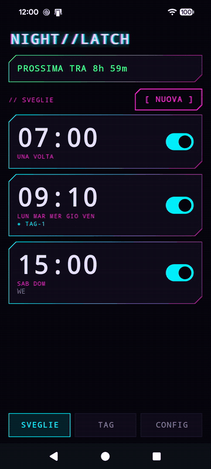

<p align="center"></p>

# NIGHT//LATCH

A cyberpunk alarm clock for Android that you can only silence by **getting up and tapping one of your own NFC tags**, for example a sticker in the bathroom or in the kitchen. If you have no tag at hand, a configurable **math unlock** works as a fallback.

No account, no subscription, no ads, no network (the app does not even have the `INTERNET` permission), no tracking.

Italian documentation: [README-ITALIAN.md](README-ITALIAN.md)

> **Language:** the screenshots below are taken with the phone set to Italian. The app is bilingual, **English and Italian**: it follows the phone language, and on Android 13+ you can pick it per app in *Settings → Apps → NightLatch → Language*.

## Screenshots

<sub>Tap an image to enlarge it.</sub>

<table align="center">
  <tr>
    <td align="center" width="25%"><a href="docs/screenshots/01-alarms.png"></a><br><sub>Alarms</sub></td>
    <td align="center" width="25%"><a href="docs/screenshots/02-alarm-edit.png"></a><br><sub>Alarm editor</sub></td>
    <td align="center" width="25%"><a href="docs/screenshots/04-tags.png"></a><br><sub>Paired NFC tags</sub></td>
    <td align="center" width="25%"><a href="docs/screenshots/05-config.png"></a><br><sub>Settings<br>(tap to see the full page)</sub></td>
  </tr>
  <tr>
    <td align="center" width="25%"><a href="docs/screenshots/06-ringing.png"></a><br><sub>Ringing</sub></td>
    <td align="center" width="25%"><a href="docs/screenshots/07-math-unlock.png"></a><br><sub>Math unlock</sub></td>
    <td align="center" width="25%"><a href="docs/screenshots/08-wake-check.png"></a><br><sub>Are you awake?</sub></td>
    <td align="center" width="25%"><a href="docs/screenshots/03-swipe-delete.png"></a><br><sub>Swipe to delete</sub></td>
  </tr>
</table>

<table align="center">
  <tr>
    <td align="center" width="50%"><br><sub>Glitch effect while ringing</sub></td>
    <td align="center" width="50%"><br><sub>Swipe left to delete</sub></td>
  </tr>
</table>

## How it works, in 30 seconds

1. **Pair your tags** in the TAG tab: any NFC sticker, card or key fob works.
2. **Create an alarm** in the ALARMS tab and choose whether **any paired tag** stops it or **only one specific tag** (e.g. the one in the bathroom).
3. When it rings, the alarm screen opens **over the lock screen** and keeps ringing until you tap the right tag, or until you solve the math unlock if you allowed it.
4. Optionally, a few minutes later the app asks **"Are you awake?"**: if you don't confirm, it rings again.

## Alarms (ALARMS tab)

- **NEW** creates an alarm; tapping an alarm opens its editor; the switch turns it on or off without deleting it.
- **Time:** dial picker, 24 h or 12 h following the phone setting.
- **Repeat days:** tap the days you want (MON…SUN). New alarms start with **no day selected**: in that case the alarm rings **once** and then turns itself off. The list shows the chosen days, *EVERY DAY* or *ONCE*.
- **Label:** optional text shown in the list and on the ringing screen.
- **Tag that stops it** (only when at least one tag is paired):
  - **Any paired tag** (default): every tag you paired stops this alarm.
  - **A specific tag:** only that tag stops it; the others are refused with *UNKNOWN TAG // ACCESS DENIED*. The list shows it under the alarm (e.g. `◉ TAG-1`), and the ringing screen says *TAP TAG: TAG-1*.
  - You can mix them: for example the weekday alarm only stops with the bathroom tag, the weekend one with any tag.
  - If you remove a tag that an alarm depends on, that alarm automatically goes back to *any paired tag*.
- **Delete:** swipe the alarm **to the left, past half its width**, and release (glitch effect, see the GIF above); release earlier and it slides back into place. Or use DELETE in the editor. There is no undo.
- The banner at the top shows the time left until the next alarm.
- Technically, alarms use `AlarmManager.setAlarmClock()`: they ring on time even in Doze and show the alarm icon in the status bar. They survive reboots, time changes and time-zone changes.

## NFC tags (TAG tab)

- **PAIR NEW TAG**, then hold the tag against the back of the phone. Up to **50 tags**, each with a name you can change (RENAME) and its UID shown below.
- The tag's identity is its **hardware UID**. NightLatch never reads or writes the tag memory, so blank, unformatted or already-used tags work too.
- **Not accepted:** bank cards, passports and phones emulating a card. They use a **random UID** that changes at every read, so they can't be recognised.
- While NightLatch is open, tags held against the phone **never open the phone's default NFC app**.

## When it rings

- The alarm screen opens **over the lock screen**, turns the screen on and keeps it on.
- **Tap a tag** (the required one, if the alarm has a specific tag).
  - **Locked phone:** most phones, **Pixel included**, don't read NFC tags while the screen is locked, and no app can change that. While the phone is locked, NightLatch shows a big *PHONE LOCKED* panel: unlock with fingerprint or face directly on the alarm screen, or tap the panel for the PIN. The alarm keeps ringing and stays on top; then tap the tag.
- **Math unlock** button (if allowed): works **even with the phone locked**.
- **Back** and the **volume keys** do nothing while it rings.
- Optional **glitch effect**: scan line, neon tear bars, the clock and the NFC prompt slice apart every few seconds. The math panel and the buttons are never glitched.

## Math unlock

A fallback for when the tag isn't at hand, or the main unlock if you don't use tags. Everything is in CONFIG, with a **live preview** of three problems.

| Level | Length | Examples |
|---|---|---|
| Easy | 1 operation, small numbers | `13 + 20`, `12 − 6`, `4 × 3`, `20 ÷ 5` |
| Normal | 1–2 operations, two-digit numbers | `31 + 39 − 28`, `3 × 5 × 9`, `36 ÷ 3 ÷ 4` |
| Hard | 2–3 operations chained, normal precedence | `12 × 6 ÷ 2 + 3`, `45 + 10 × 10`, `63 ÷ 3 ÷ 7` |

- **Operations:** turn `+ − × ÷` on or off; the choice applies to every level, at least one stays on.
- **Exercises to solve:** from 1 to 10. A wrong answer generates a new problem without losing the ones already solved.
- Divisions are always exact, results are always positive whole numbers.
- **Also dismiss with math** (switch): turn it off if you want the tag to be the only way.
  It is **forced on anyway** when a tag can't be used: no tag paired, phone without NFC, or NFC switched off. An alarm can never become impossible to stop.

## "Are you awake?" check (optional)

- Turn it on in CONFIG → EXTRAS and choose **3, 5 or 10 minutes**.
- That long after you stop the alarm (with a tag or with math), the screen shows *ARE YOU AWAKE?* with a **60-second countdown** and soft vibration pulses.
- Confirm with the **I AM AWAKE** button. Tags don't count here, on purpose: you have to be looking at the phone.
- No confirmation in time → the alarm **rings again**, and after you stop it the check comes back.

## Sound

- **Ringtone:** any alarm sound from the system picker (falls back to the default alarm sound if the chosen one can't be played).
- **Vibration** on/off.
- **Lock alarm volume at maximum:** if someone (you, half asleep) lowers the alarm volume, it goes back up within a second.
- **Rising volume** (optional): starts at −30 dB and rises steadily (linear in dB, so it *sounds* even) to full volume in **15, 30 or 60 seconds**.
- **Phone calls:** while a call is ringing or in progress (including VoIP calls), the alarm sound pauses and vibration continues; it resumes when the call ends.

## Cosmetic options

- **Glitch effect on the ringing screen** (on by default).
- **Unlock name:** how the math unlock is called in the app. It changes only the wording, not how it works:

| Option | Button on the ringing screen | Counter |
|---|---|---|
| Math (default) | MATH UNLOCK | EXERCISE 2 / 3 |
| Cipher code | DECRYPT THE CODE | CODE 2 / 3 |
| Numeric override | NUMERIC OVERRIDE | SEQUENCE 2 / 3 |
| Operations | SOLVE THE OPERATIONS | 2 / 3 |

## Backup

CONFIG → BACKUP: **EXPORT** saves alarms, paired tags and settings to a JSON file you choose; **IMPORT** restores them, for example on a new phone. Every value is validated on import; a file that isn't a valid NightLatch backup changes nothing. Android's automatic cloud backup is disabled on purpose, so this is the way to move your setup.

## Hard to escape while ringing

- **Backup ring:** while ringing, a second exact alarm is kept 60 seconds ahead. If the app is killed (swiped away from recents, killed by the phone maker's battery manager, crash), the ringing restarts within a minute.
- **Reboot / update:** if the phone reboots or the app is updated while ringing, it rings again.
- **No auto-silence:** it rings until you stop it.
- **Guardian** (optional accessibility service, see below): blocks Settings, the launcher, the notification shade and the power menu while ringing.

### Guardian

While an alarm is ringing, Guardian sends you back to the alarm if you open **Settings** (force stop, uninstall), the **launcher**, the **notification shade** or the **power menu**.

- **Phone, dialer and emergency calls are always allowed.**
- It only sees the **package name** of the app in the foreground, never the screen content, and **does nothing when no alarm is ringing**.
- **Fail-open:** if the ring service has been dead for more than 5 minutes and the backup ring couldn't revive it, Guardian stops blocking, so the phone is never locked with nothing ringing.
- Enable it in *Settings → Accessibility → NightLatch Guardian*. If the switch is greyed out, see [Restricted settings](#restricted-settings-apk-installed-outside-the-play-store).

### What no app can prevent

Force-stop through `adb`, booting into safe mode, turning the phone off or removing the battery. Force-stop from Settings also cancels every alarm the app scheduled, which is why Guardian blocks Settings while an alarm rings.

### Emergency stop

For real emergencies only: an NFC tag that broke or got lost, a phone with a broken NFC reader, an alarm ringing in the middle of a meeting.

<details>
<summary>⚠️ <b>Lazy people: DO NOT open this.</b> If you know it, you will use it every morning and NightLatch becomes a normal alarm clock.</summary>

<br>

While the alarm is ringing, keep **two fingers on the screen** for the whole sequence and press:

1. Volume **down**
2. Volume **down**
3. Volume **up**
4. Volume **up**
5. Volume **down**, held for **5 seconds**

Short presses (under 1 second each), no more than 3 seconds between one step and the next. If you lift the fingers, press the wrong key or release the last one early, start over.

</details>

## Permissions and first setup

On first launch a **setup wizard** lists what is needed, each item with a FIX button that opens the right system page. Later, if Android revokes something (it happens after updates of sideloaded apps), a **red banner** appears at the top of the app and, after an update or a reboot, a **notification** opens the right page with one tap. A **yellow banner** suggests the recommended ones. Everything is also in CONFIG → SYSTEM STATUS.

| Permission | Required? | Why |
|---|---|---|
| Notifications | Required (Android 13+) | Shows the ringing alarm |
| Full-screen alarm | Required (Android 14+) | Opens the alarm screen over the lock screen |
| Display over other apps | Required | Lets the alarm screen open even when Android drops the full-screen alarm (e.g. after an update) |
| Exact alarms | Required (Android 12+) | Rings at the exact minute |
| Unrestricted battery | Recommended | Stops the phone maker's battery saver from killing the alarm |
| NFC on | Recommended | Needed to stop the alarm with tags |
| Guardian (accessibility) | Optional | Anti-escape while ringing |

### Restricted settings (APK installed outside the Play Store)
On Android 13 and newer, Android blocks some settings of apps installed from an APK until you unlock them by hand: **Guardian** (accessibility) from Android 13 and **Display over other apps** from Android 15. The switch looks greyed out or Android says *Restricted setting*. The setup wizard explains it and has an **OPEN APP INFO** button.

1. Try to turn the setting on once: Android shows the block, and only after that does it offer the option in step 2.
2. Open *App info* for NightLatch → **⋮** (top right) → **Allow restricted settings**, and confirm with PIN, fingerprint or face.
3. Go back and turn the setting on.

## Privacy

No account, no network permission, no analytics, no ads. Alarms, tag UIDs and settings stay in the app's private storage on the phone. Guardian, if enabled, only looks at which app is in the foreground while an alarm rings.

## Requirements

- Android 8.0 (API 26) or newer. NFC is optional (without it, alarms stop with the math unlock).
- To build: JDK 17 and the Android SDK (platform 36). Android Studio is the easiest setup.

## Build

```bash
./gradlew testDebugUnitTest   # JVM unit tests (math generator, scheduling incl. DST, NFC UIDs)
./gradlew assembleDebug       # -> app/build/outputs/apk/debug/app-debug.apk
./gradlew assembleRelease     # signed if keystore.properties exists (see below)
```

Windows (PowerShell): `.\gradlew.bat assembleDebug`

### Release signing (local)
1. Create a keystore once and keep it safe; every update must be signed with the same key:
   `keytool -genkeypair -v -keystore nightlatch.jks -keyalg RSA -keysize 4096 -validity 10000 -alias nightlatch`
2. `cp keystore.properties.example keystore.properties` and fill it in. Both files are git-ignored; never commit them.
3. `./gradlew assembleRelease`

### GitHub Actions
Every push to `main` runs the unit tests and lint, builds the debug APK and uploads everything as artifacts (*Actions → run → Artifacts*). Debug builds from CI are signed with a throwaway key, so installing one over another requires uninstalling first.

To get a **signed release APK** from CI that installs as an update, add these repository secrets (*Settings → Secrets and variables → Actions*):

| Secret | Value |
|---|---|
| `NIGHTLATCH_KEYSTORE_B64` | the keystore in base64 (PowerShell: `[Convert]::ToBase64String([IO.File]::ReadAllBytes("nightlatch.jks")) \| Set-Clipboard`) |
| `NIGHTLATCH_STORE_PASSWORD` | keystore password |
| `NIGHTLATCH_KEY_ALIAS` | key alias (e.g. `nightlatch`) |
| `NIGHTLATCH_KEY_PASSWORD` | key password |

The keystore exists on the runner only for the duration of the job.

### Publishing a release
Pushing a version tag publishes a **GitHub Release** with the APK signed with your key (`.github/workflows/release.yml`):

1. Bump `versionCode` and `versionName` in `app/build.gradle.kts`.
2. Optional release notes: `fastlane/metadata/android/en-US/changelogs/<versionCode>.txt` (and `it-IT`).
3. Tag and push: `git tag -s v1.0.0 -m "NightLatch 1.0.0"` then `git push origin v1.0.0`.

The workflow refuses to publish if the tag doesn't match `versionName`, if the signing secrets are missing or if the APK is debug-signed. The release contains `NightLatch-vX.Y.Z.apk`, its SHA-256 and the signing certificate fingerprint, so users can verify they are installing your build.

## Install and test

1. Install the APK: `adb install -r app-release.apk`, or open it on the phone.
2. Follow the setup wizard until every required row shows `[ OK ]`.
3. **TAG → PAIR NEW TAG** for each tag.
4. Set an alarm one or two minutes ahead and test it: screen off, phone locked, in Doze (`adb shell dumpsys deviceidle force-idle`), after swiping the app away from recents, with Do Not Disturb on.

## Project layout

```
app/src/main/java/io/github/leproide/nightlatch/
  NightLatchApp.kt                 notification channels
  data/Models.kt, Store.kt         alarms, tags, settings, ringing state, backup (validated JSON in private prefs)
  alarm/AlarmScheduler.kt          setAlarmClock, next trigger (DST-safe), backup ring, wake check
  alarm/AlarmReceiver.kt           alarm / backup / wake-check triggers
  alarm/SystemEventsReceiver.kt    reboot / time change / update -> reschedule, resume ringing, permission reminder
  alarm/RingService.kt             foreground service: sound, vibration, call pause, rising volume, volume lock, wake check
  alarm/GuardianService.kt         optional accessibility anti-escape
  alarm/Permissions.kt             required/recommended permissions and their settings pages
  nfc/NfcUid.kt, TagScanner.kt     UID normalisation, reader mode
  math/MathChallenge.kt            problem generator
  ui/                              Compose UI (activities, screens, cyberpunk theme, glitch effects, wording)
app/src/test/                      JVM unit tests
docs/screenshots/                  README screenshots and GIFs
fastlane/metadata/android/         store listing metadata (F-Droid / IzzyOnDroid)
```

## License

NightLatch is free software released under the **GNU General Public License v3.0** (or, at your option, any later version). See [LICENSE](LICENSE) for the full text.

## Author

https://github.com/Leproide
